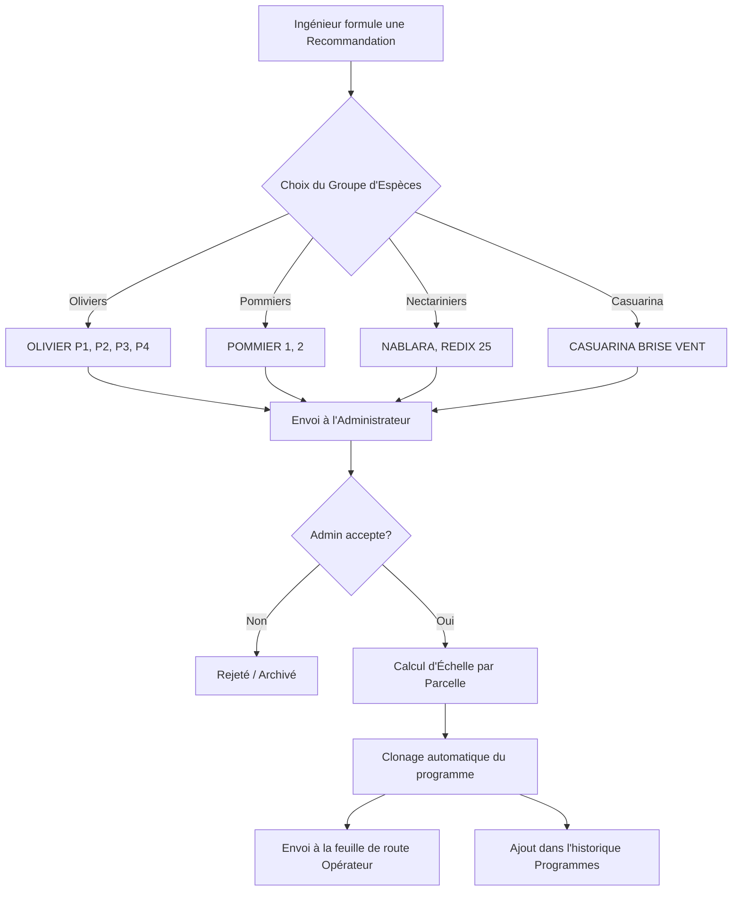

# Product Requirement Document (PRD) — Farm Friendy

Ce document définit les spécifications fonctionnelles et techniques de l'application **Farm Friendy**, un outil de gestion agricole intelligent et connecté, axé sur le suivi des parcelles, la prescription agronomique et l'assistance à l'exécution de terrain.

---

## 1. Vision et Objectifs
L'application a pour but de fluidifier la communication et la traçabilité entre trois acteurs clés de l'exploitation agricole :
*   **L'Ingénieur Agronome** : Prescrit des traitements ciblés et des programmes de nutrition.
*   **L'Administrateur** : Supervise l'exploitation, valide financièrement et agronomiquement les recommandations, et pilote la logistique.
*   **L'Exécutant (Opérateur de terrain)** : Exécute les tâches au jour le jour avec un assistant vocal et sonore, et remonte les anomalies de terrain.

L'application doit fonctionner de manière fluide dans des conditions réseau dégradées (offline-first) grâce à une synchronisation locale persistante.

---

## 2. Rôles et Droits d'Accès

L'application implémente un système de contrôle d'accès basé sur trois rôles distincts :

| Rôle | Onglets Accessibles | Fonctionnalités Clés |
| :--- | :--- | :--- |
| **Administrateur** | Accueil, Programmes, Tâche, Maintenance | Validation des recommandations ingénieur, planification directe, suivi financier global, gestion des anomalies opérationnelles. |
| **Ingénieur** | Accueil, Recos | Prescription agronomique par espèce ciblée (groupe), accès en lecture aux parcelles pour analyse, émission de diagnostics. |
| **Exécutant** | Aujourd'hui, Parcelles, Historique, Rappels, Profil | Feuille de route quotidienne, assistant d'exécution vocale de fertilisation, rapport de fin de tâche (météo, photos), signalement d'anomalies. |

---

## 3. Spécifications Fonctionnelles des Modules

### 3.1. Roue Interactive des Parcelles (ParcelWheel)
*   **Vue Graphique** : Représentation circulaire segmentée des parcelles de la ferme.
*   **Indicateur de Statut** : Chaque segment est coloré selon l'état de la parcelle (`sain` en vert, `alerte` en orange/triangle, `intervention` en rouge).
*   **Bulle Centrale Dynamique** :
    *   *Administrateur* : Bulle scindée en deux. À gauche : anomalies opérationnelles signalées par l'exécutant. À droite : recommandations agronomiques en attente de l'ingénieur.
    *   *Ingénieur / Exécutant* : Bulle unifiée **EXÉCUTANT** affichant le nombre de tâches en cours.

### 3.2. Calculateur de Fertilisation Intelligent (Excel V9)
Intègre la logique scientifique du modèle Excel de référence :
*   **Restriction Stricte par Cuve (Bac)** : Pour éviter les réactions chimiques indésirables (précipités), les produits sont cantonnés à leurs bacs respectifs :
    *   **Bac A (Calcium & Acide)** : Nitrate de Calcium, Acide Nitrique.
    *   **Bac B (Macro-éléments & Phosphore)** : Urée, Nitrate/Sulfate de Potassium, Nitrate/Sulfate de Magnésium, MAP, MKP, DAP, Sulfate/Nitrate d'Ammonium, Acide Phosphorique.
    *   **Bac C (Organique & Fer)** : Acide Humique, Fer 6%.
    *   **Bac D (Nettoyage & Oligo-éléments)** : Acide Citrique, Acide Ascorbique, Oligo-éléments.
*   **Formule Logistique de Préparation** :
    *   *Eau Minimale de Dissolution* : Calculée selon le seuil de solubilité propre à chaque produit avec un coefficient de sécurité de 1.5x.
    *   *Volume de Solution Estimé* : `Eau Initiale + (Somme des Doses Totales en kg ou L) * 0.6` (coefficient de déplacement volumétrique).
    *   *Alerte Trop-Plein* : Déclenchement d'un avertissement visuel clignotant rouge si le volume final dépasse la capacité de la cuve (1000 L).
*   **Calculateur Financier** : Calcule le coût par passage et le coût hebdomadaire (coût unitaire * dose totale * fréquence).

### 3.3. Assistant d'Exécution Guidée pour l'Exécutant
*   **Progression Étape par Étape** : Guide l'opérateur à travers les phases critiques :
    1.  *Volume d'Eau initial* : Remplissage de la cuve avec la quantité calculée.
    2.  *Introduction séquentielle* : Ordre et temps d'agitation requis pour chaque produit.
    3.  *Validation finale* : Rapport d'exécution.
*   **Synthèse Vocale (SpeechSynthesis)** : Annonce oralement en français les actions requises (ex: *"Ajoutez 25 kg d'Urée dans le Bac B. Lancez l'agitation pendant 10 minutes"*).
*   **Témoins Sonores (Web Audio API)** : Génère des signaux audio clairs pour les transitions et les alertes sans dépendance externe, assurant un fonctionnement 100% offline.
*   **Rapport de fin** : Saisie de la météo (vent, température), commentaire, et capture de photos (jusqu'à 6 photos descriptives).

### 3.4. Flux de Recommandation et Validation (Clonage & Échelle)

*   **Calcul d'Échelle** : Lors de la validation par l'Administrateur, le coût et les dosages sont automatiquement multipliés par la surface réelle (hectares) de chaque parcelle cible.
*   **Alerte Phytosanitaire** : L'acceptation d'un programme phytosanitaire bascule automatiquement les parcelles cibles en état `alerte`.

---

## 4. Architecture Technique & Base de Données

### 4.1. Modèle de Données (Supabase)

#### Table `module_records` (Stockage des Programmes)
```sql
CREATE TABLE module_records (
  id UUID PRIMARY KEY DEFAULT gen_random_uuid(),
  parcel_id VARCHAR NOT NULL,
  kind VARCHAR NOT NULL, -- 'irrigation', 'fertilisation', 'pulverisation', 'phytosanitaire'
  payload JSONB NOT NULL, -- Détails de la prescription, fréquences, produits
  total_cost NUMERIC DEFAULT 0,
  scheduled_at TIMESTAMP WITH TIME ZONE,
  executed_at TIMESTAMP WITH TIME ZONE,
  executed_by UUID REFERENCES auth.users(id),
  assigned_to UUID REFERENCES auth.users(id),
  status VARCHAR DEFAULT 'planifie', -- 'planifie', 'en_cours', 'execute', 'annule'
  created_by UUID REFERENCES auth.users(id),
  created_at TIMESTAMP WITH TIME ZONE DEFAULT timezone('utc'::text, now())
);
```

#### Table `recommendations` (Prescriptions de l'Ingénieur)
```sql
CREATE TABLE recommendations (
  id UUID PRIMARY KEY DEFAULT gen_random_uuid(),
  kind VARCHAR NOT NULL, -- 'fertilisation', 'phytosanitaire', 'irrigation'
  title VARCHAR NOT NULL,
  comment TEXT,
  parcel_ids VARCHAR[] DEFAULT '{}',
  payload JSONB NOT NULL, -- crop_group, method, program
  photo_urls TEXT[] DEFAULT '{}',
  status VARCHAR DEFAULT 'envoyee', -- 'envoyee', 'acceptee', 'rejetee'
  created_by UUID REFERENCES auth.users(id),
  reviewed_by UUID REFERENCES auth.users(id),
  reviewed_at TIMESTAMP WITH TIME ZONE,
  created_at TIMESTAMP WITH TIME ZONE DEFAULT timezone('utc'::text, now())
);
```

### 4.2. Stratégie Offline-First
1.  **Stockage Local (Dexie.js / IndexedDB)** : Double écriture systématique de chaque action utilisateur en local.
2.  **Boîte d'Envoi (Outbox Queue)** : Les transactions réseaux non urgentes sont empilées dans une file d'attente d'envoi.
3.  **Moteur de Synchronisation automatique** : Dès que l'état du réseau (détecté par le navigateur) repasse à `online`, un worker dépile et synchronise les données avec Supabase.
4.  **Compression et mise en cache des Photos** : Les photos prises sur le terrain sont stockées localement en basse résolution avant d'être envoyées sur le bucket Supabase Storage lors du retour de connexion.

---

## 5. Exigences d'Interface et d'Aesthetics
*   **Design Premium** : Utilisation d'un thème moderne, sombre/lumineux hybride, avec des dégradés subtils inspirés de la nature (couleurs olives, terre, ciel).
*   **Zéro Placeholder** : Tous les visuels, graphiques et photos d'illustration sont réels ou générés dynamiquement.
*   **Micro-animations** : Transitions fluides pour le minuteur, les alertes clignotantes de trop-plein, et les rotations de la roue des parcelles.
